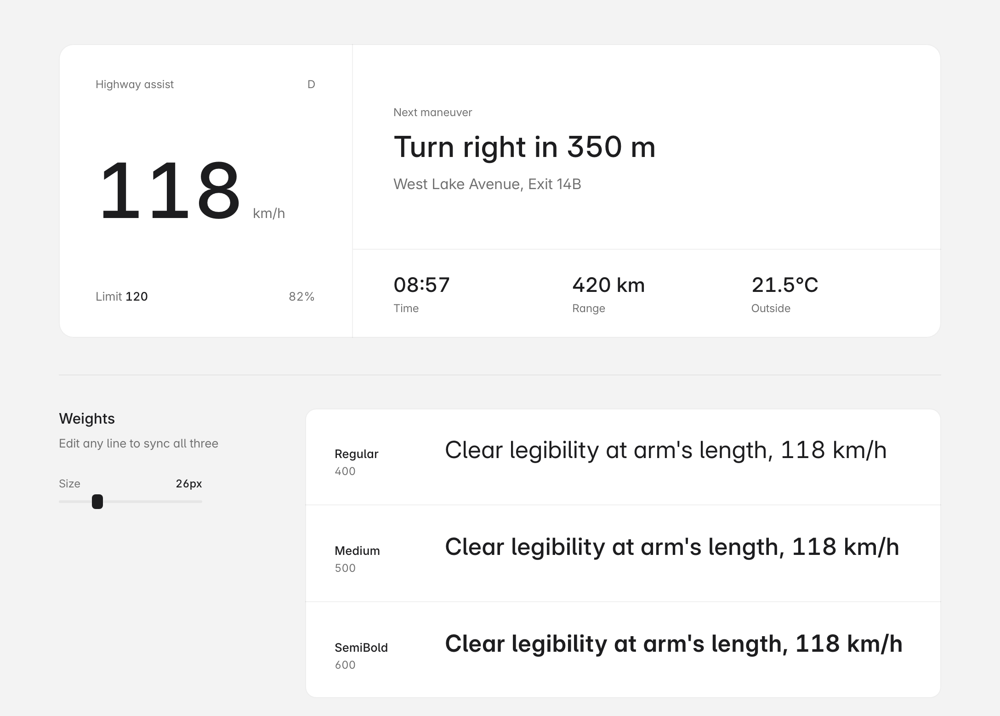
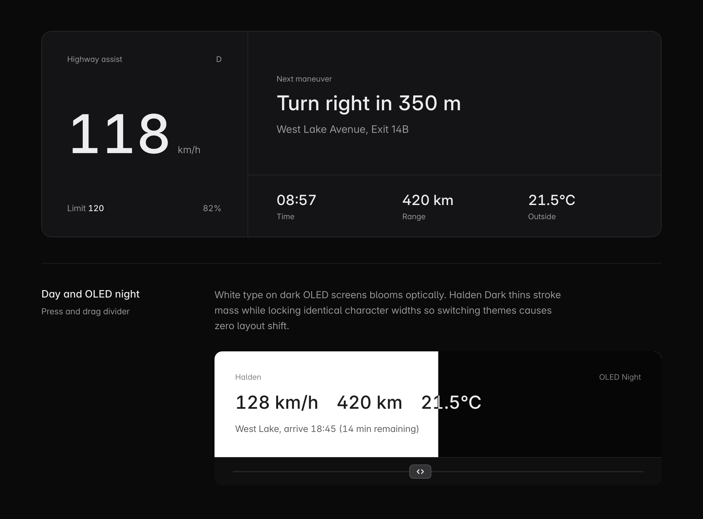
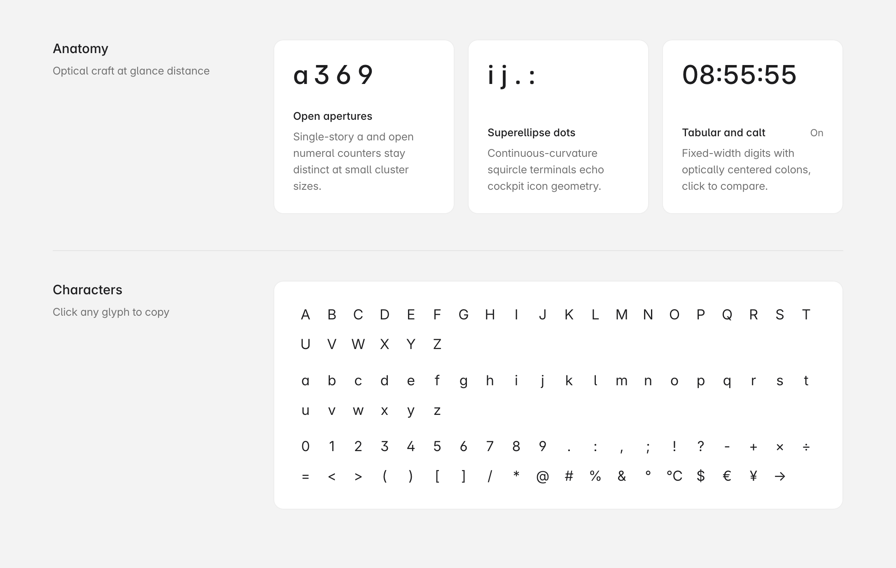

# Halden

**An open-source HMI and interface sans-serif with OLED dark-mode optical compensation.** Built for automotive cockpits, design tools, and quiet editorial clarity. Used in [DriveScene Studio](https://www.drivescenestudio.com/), [Dashline](https://paxton0209.github.io/Dashline/), and [Dashnote](https://paxton0209.github.io/dashnote/).

[Open live specimen](https://paxton0209.github.io/halden/) · [Download v1.1.0](https://github.com/Paxton0209/halden/releases/latest) · [Fontlog](FONTLOG.txt) · [中文说明](#中文说明) · [License](OFL.txt)



## Why this typeface exists

In a vehicle cockpit, text is read at arm's length in brief glances while the driver's attention stays on the road. Standard editorial fonts often close up at small cluster sizes, leave `I`, `l`, and `1` too close in shape, or bloom optically when rendered white-on-black on dark OLED displays at night.

Halden starts from the open Inter base and fits its proportions, widths, and spacing for interface legibility (`x-height / cap = 0.736`). It stays calm at `letter-spacing: 0em` across light editorial pages and dark cockpit panels without manual tracking fixes.

## Three optical families, nine static cuts

| Family | Weights | Optical tuning | Intended use |
| --- | --- | --- | --- |
| `Halden` | Regular 400, Medium 500, SemiBold 600 | Text (`opsz = 16`) | UI labels, navigation prompts, settings, light-mode interfaces |
| `Halden Display` | Regular 400, Medium 500, SemiBold 600 | Display (`opsz = 28`) | Speed readouts, large telemetry numerals, mastheads, headings |
| `Halden Dark` | Regular 400, Medium 500, SemiBold 600 | OLED Dark Grade (thinned stroke mass, locked widths) | Dark-mode cockpits and OLED screens without layout shift |

## Day and OLED night

White type on dark OLED panels appears optically heavier than the same glyphs set dark-on-light. `Halden Dark` reduces stroke mass for night readability while locking identical character advance widths to `Halden`, so switching between day and night themes produces zero reflow or horizontal jitter.



## Anatomy and OpenType details

- **Open apertures and disambiguated defaults:** single-story `a`, single-story `g`, a restrained bottom hook on `l` to separate `I / l / 1` in rapid glances, and open counters on `3`, `4`, `6`, and `9`.
- **Superellipse dots:** continuous-curvature squircle terminals on `i`, `j`, `.`, and `:` that match automotive cockpit icon geometry.
- **Contextual alignment (`calt`) and tabular numerals:** colons (`08:45`, `12:54`) and hyphens/en-dashes (`2026-0417`, `08:45–17:30`) automatically center vertically between digits, with fixed-width figures preventing jitter in live clocks and speedometers.
- **Verified GPOS kerning:** 2,933 glyphs per weight across all 9 static cuts, with restored collision-free kerning.



## Use it

### Web

Load `fonts.css` directly or copy `webfonts/` and `fonts.css` into your project:

```html
<link rel="stylesheet" href="https://paxton0209.github.io/halden/fonts.css">
```

```css
:root {
  font-family: "Halden", -apple-system, BlinkMacSystemFont, sans-serif;
  font-feature-settings: "calt" 1, "kern" 1;
  letter-spacing: 0;
}

:root[data-theme="dark"] {
  font-family: "Halden Dark", "Halden", -apple-system, sans-serif;
}

.speed-readout,
h1 {
  font-family: "Halden Display", "Halden", -apple-system, sans-serif;
  font-variant-numeric: tabular-nums;
}
```

### Desktop and Figma

Download the latest release archive from [Releases](https://github.com/Paxton0209/halden/releases/latest) or install the 9 TrueType files from [`ttf/`](ttf/) directly onto macOS or Windows.

## Repository contents

| Path | Description |
| --- | --- |
| `ttf/` | 9 desktop TrueType fonts (`Halden`, `HaldenDisplay`, `HaldenDark` in Regular, Medium, SemiBold) |
| `webfonts/` | 9 web-optimized WOFF2 fonts matching `ttf/` |
| `fonts.css` | Ready-to-use `@font-face` stylesheet for all three optical families |
| `index.html` | Interactive live specimen (cockpit cluster, linked 3-weight tester, OLED split comparator, glyph map) |
| `docs/images/` | Rendered specimen plates used in this README |
| `media/` | Halden v1.1 launch film (`Halden-v1.1-Launch-20s.mp4`) and poster |
| `FONTLOG.txt` | Parametric optical fitting metrics, build provenance, and changelog |
| `OFL.txt` | SIL Open Font License 1.1 |

## Local preview

```bash
python3 -m http.server 8000
```

Then open `http://localhost:8000`. Press `D` on the live specimen to switch between Day (`Halden`) and OLED Night (`Halden Dark`).

## Provenance and license

Licensed under the [SIL Open Font License 1.1](OFL.txt). Free for personal, commercial, web, desktop, and automotive HMI embedding.

Halden is built as an OFL derivative of [Inter](https://github.com/rsms/inter) (original design by Rasmus Andersson), modified by [Paxton Yao](https://github.com/Paxton0209) with parametric optical fitting, default alternate baking, restrained `l`-hook geometry, superellipse dots, OLED dark-grade compensation, and contextual `calt` alignment. Full build details are recorded in [FONTLOG.txt](FONTLOG.txt).

---

## 中文说明

**Halden 是一套面向汽车座舱 HMI 与界面设计的开源无衬线字体，内置深色 OLED 光学补偿版本。** 目前已用于 [DriveScene Studio](https://www.drivescenestudio.com/)、[Dashline](https://paxton0209.github.io/Dashline/) 与 [Dashnote](https://paxton0209.github.io/dashnote/)。

整套字体包含三个光学家族、共 9 个静态字重，提供 TTF 与 WOFF2 两种格式。

- **Halden（正文，400 / 500 / 600）** 面向常规界面标签、导航提示与浅色页面，默认 `letter-spacing: 0` 即可保持清晰节奏。
- **Halden Display（展示，400 / 500 / 600）** 面向车速表、大号遥测数字与标题。
- **Halden Dark（深色 OLED 补偿，400 / 500 / 600）** 针对深色屏白字发虚问题减薄笔画重量，同时锁死字符宽度，日夜切换时页面零抖动。

默认内置单层 `a` 与 `g`、克制底钩 `l`（降低驾驶扫视下 `I / l / 1` 混淆）、超椭圆圆点，以及 `calt` 上下文冒号居中与等宽数字。采用 [SIL Open Font License 1.1](OFL.txt) 协议，可免费用于个人、商业、网页、桌面与车载 HMI 嵌入。
